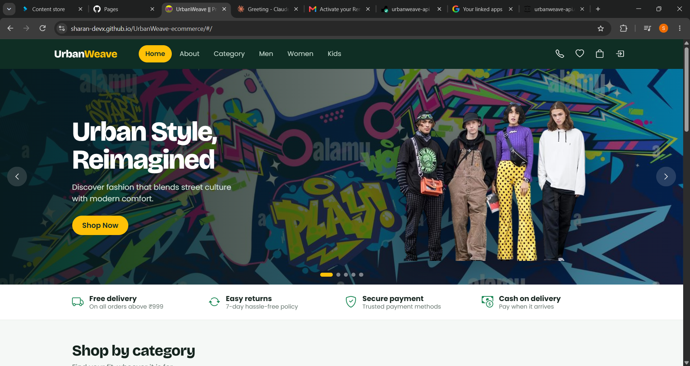
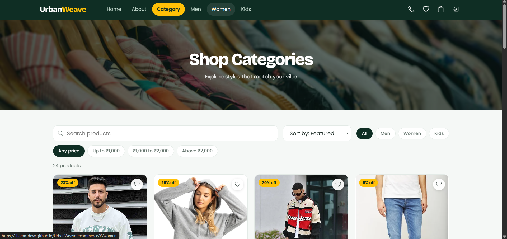
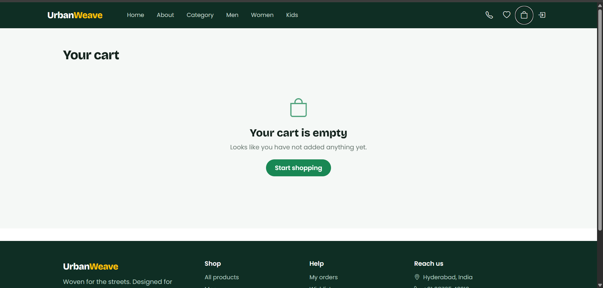

# UrbanWeave

🔗 **Live demo:** https://sharan-devx.github.io/UrbanWeave-ecommerce/

## Screenshots




React + Vite fashion storefront with an admin dashboard. Data is served by
[json-server](https://github.com/typicode/json-server) from `../db.json`.

## Features
- Product categories: Men, Women, Kids
- Shopping cart and wishlist
- Login page
- Admin dashboard

## Run it

```bash
npm install
npm run server   # API on http://localhost:3001  (terminal 1)
npm run dev      # app on http://localhost:5173  (terminal 2)
```

## Scripts

| Command | What it does |
| --- | --- |
| `npm run dev` | Start the Vite dev server |
| `npm run server` | Start json-server on port 3001 |
| `npm run build` | Production build into `dist/` |
| `npm run lint` | Run ESLint |

Set `VITE_API_URL` (see `.env.example`) to use a different API address.
